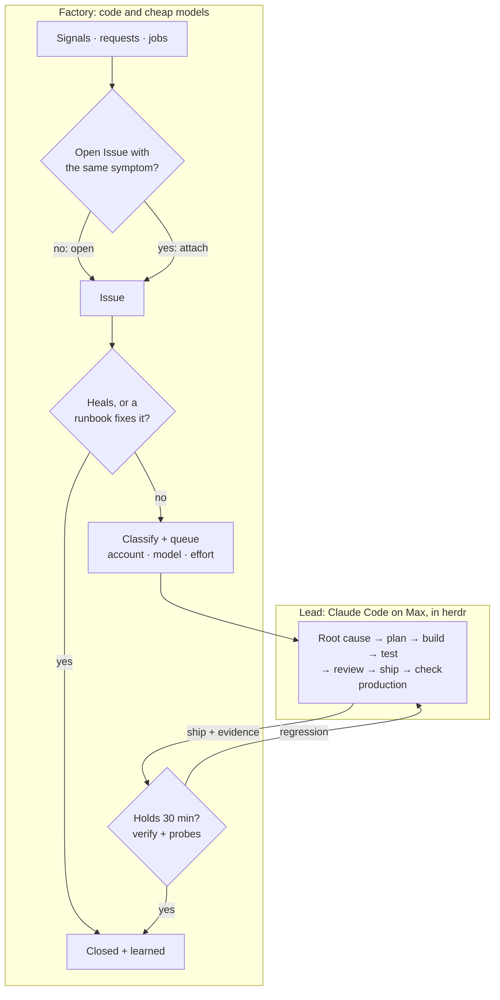
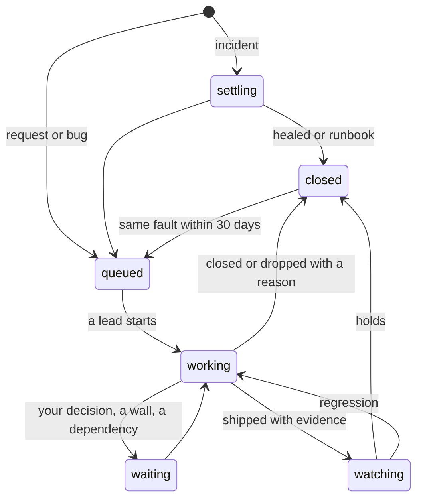

# 4. The loop

**The factory runs the lifecycle; Claude Code does the work.** The factory takes everything in, merges
duplicates, heals what a runbook can heal, and queues the rest. When capacity allows, it starts a
Claude Code session in herdr, the *lead*, with the problem and its evidence. The lead owns the Issue:
it finds the cause, plans, builds, tests, reviews, ships, checks production and reports back. The
factory then watches the result, closes the Issue and learns from it.

## Who owns which step

| Step | Owner | Engine | Out |
|-|-|-|-|
| **Intake** | factory | a poller per source; requests skip to *Classify* | Signal |
| **Dedup by symptom** | factory | rules; a cheap judge for the ambiguous rest once its shadow run earns trust (§8) | a new Issue, or a Signal attached to an open one |
| **Settle + runbook** | factory | a grace timer; a runbook from `project.yaml` | healed and closed, or on to the queue |
| **Classify** | factory | one cheap-model call | project, kind, class, size; the lead's model and effort |
| **Queue + admit** | factory | the picker, by class and 5-hour headroom (§5) | an account now, or a time to wait until |
| **Spawn** | factory | the `Runner` (herdr), in a worktree of the lead's own (§6) | a lead with the brief |
| **Root cause → production** | **lead** | Claude Code on Max, alone or with workers | shipped with evidence, closed, blocked or asking |
| **Watch** | factory | the hold, then `make verify` and the project's probes; its signals | holds → closed; regression → back to the lead |
| **Learn** | factory | cheap model, from the lead's report | known fix, dedup labels, runbook candidates, changelog |

**The factory never reasons about code or causes.** It sorts, waits, counts and remembers. Anything
that needs understanding a problem belongs to the lead.

## Three ways in

- **Signals** from sources and jobs become `incident`, `bug` or `upkeep` Issues after dedup.
- **Requests** go straight to *Classify*, with no dedup or settle: Argo, Hermes, `factory issue new`,
  a TickTick item tagged `#factory`, a GitHub issue in one of your repos labelled `factory`, or any
  issue where you comment `/factory`. A label, not authorship, starts work, because every agent on
  the mini acts as your GitHub user; an issue labelled `alert` (weatherorb's alerts) is a signal. The
  factory never triggers on its own comments, and a source it cannot parse triggers nothing.
- **Initiatives**: a request too big for one lead is classified `initiative` and wakes the
  orchestrator, which plans it into waves: child Issues with their dependencies.

Every repo under `~/SourceRoot` takes requests, with or without a `project.yaml`; the manifest adds
signals, runbooks, the hold and probes (§7). IuRoot stays outside. So do the herdr sessions you start
yourself: Hermes files a request when you ask it to do something, and opens a plain session (`rd work`)
only when you ask for a session.

## The lead's job

| Phase | The lead | With |
|-|-|-|
| **Investigate** | reproduces, reads logs and traces, finds the cause; merges or splits Issues when the cause says so | `/otel`, `make logs`, chrome-devtools, `factory issue show\|merge\|split` |
| **Plan** | picks the approach and the shape of the work: alone, subagents, `rd fan` worktrees or a `/wave` chain | `/research`, the project's docs |
| **Build** | implements and writes the tests | `@implementer`, `rd fan` |
| **Check** | `make check` and `make test`; a review from another model family | `/check`, `/review` |
| **Verify locally** | sees it work: screenshots, traces, timings | `@verifier`, chrome-devtools, Lighthouse |
| **Ship** | merges by the project's `ship` rules and deploys by its `deploy.mode` (§7) | `make deploy`, `/ship` |
| **Check production** | the same evidence against the running system; error rate and p95 before and after | `make verify`, `/otel`, screenshots |
| **Report** | `factory issue ship` with a three-line summary and the evidence | `factory` |

**Production says no → the lead fixes forward.** It still holds the context. Reverting is its call
when a revert is the fastest safe fix (a stateless container, say), never a factory reflex. Infra,
dotfiles and data changes rarely revert cleanly anyway.

## Done means evidence

The factory derives the evidence an Issue needs from what its merged commits touched (§7's `deploy`
and `ship`), so a lead cannot pick a lighter bar: `ship` is refused without that evidence, and
`close` is refused when the commits touch deployable paths. The factory checks that the evidence is
there and fresh: a screenshot newer than the deploy, a deployed version from `make verify` that
contains the merged commit. Judging it stays with the lead and the review.

| Change | Evidence |
|-|-|
| UI | a production screenshot of the changed screen, at phone width too if the page is used there |
| API or service | `make verify`; error rate and p95 of the changed endpoints, before and after |
| Infra or config | the service's status and logs after the change |
| Data or migration | the queries that show the data is right |
| Nothing deployed (docs, analysis), or a repo without a `deploy` block | the commit or the document, via `factory issue close` |

**No lead edits a probe within the Issue it is shipping.** Each deployable project lists a few
user-journey probes in `project.yaml`: can I log in, does the forecast load, does the upload finish.
Each passes or fails, never averaged. The factory runs them after every hold, next to `make verify`.
Probes change only through an Issue of their own. Tests a model wrote for its own
change can give false confidence, and the probes are the check that does not depend on it.

## The brief: the problem, never a diagnosis

A lead reasons better from facts than from a weaker model's guess, so the brief carries no
cheap-model root cause and no cheap-model plan.

- **The ask:** your words, or what the signals saw: what, where, since when, how often.
- **Facts:** the raw signals, the commands that pull their logs and traces, the project's last
  deploys and commits. Alert and issue text is marked as data, never instructions.
- **History:** closed Issues that looked similar, with the cause and fix their lead verified, marked
  *past, may not apply*.
- **The project:** its make contract, deploy mode, how each path ships, production targets.
- **Done means:** the evidence table above and the `factory` verbs.
- **Standing orders:** decide alone except the four business classes; ask through `factory issue ask`;
  no turn or time limits; workers stay on Max.

Classification sets labels (project, kind, class, size) and routing (account, model, effort), never a
cause; of its output, the brief shows just kind and class. The standing orders are identical in every brief, so they are a prompt-cache hit.

## Following a running lead

- **Turn ends are events, not guesses.** The lead's Stop hook reports every turn end and its
  SessionEnd hook the session's end, straight into the Issue's inbox. engrams learned that inferring
  turn ends from output wedges sessions. Witness reads herdr every minute as the backstop (blocked,
  walled, dead) and records the account in effect. The lead's `factory` reports are authoritative,
  and the server validates each one against its schema.
- **The hooks act only in factory sessions and never block one.** The launcher sets `FACTORY_SESSION`;
  without it every hook exits at once, so your own sessions and the build's never see them. When the
  factory does not answer, a hook or a `factory issue` call appends its event to a local spool, which
  the factory replays on start; the idempotency keys make the replay safe.
- **A Stop hook keeps the lead honest, and only then.** It sends the lead back with one line (report
  `ship`, `close`, `block`, `ask` or `wait`) when all three hold: nothing reported since the last
  prompt, no declared wait, and the turn did not end on a usage limit. `factory issue wait --on
  workers|deploy|owner` is the report for a lead whose `rd fan` worktrees or deploy are still running.
  A turn that answers a message you typed is never sent back. Claude Code continues a session
  when a Stop hook exits with code 2, and `stop_hook_active` stops it looping. A second unreported stop
  parks the Issue with a line for you, never a card.
- **New facts go to the running lead.** A signal linked as *possibly related* to an Issue in work (by
  the rules, and by the judge once trusted) reaches that lead as a note, not a second session. The lead
  records whether it shares the cause; that answer is the judge's label (§8).
- **Notes go through the factory.** The factory and the orchestrator write to a lead only with
  `factory issue note`, which records each note under its prompt id and types it once. The factory
  alone owns `lead-*` panes: herdr-reap skips them, and the stall rule (§5) replaces any idle watchdog.
- **You can step in at any time:** open the lead's tab and type. The lead treats your message like a
  note, and the factory keeps following.
- **Walls:** Witness marks a walled lead and resumes it when its window resets. If the wait would pass
  an hour and the other account has headroom, the lead resumes there by session id instead (§5); the
  prompt cache is gone after such a wait either way.
- **After ship** the lead stays open and idle through the 30-minute hold, so a regression reaches it
  while its context is warm. Once the hold has passed and `make verify` and the probes are green, the
  factory closes the tab and removes the worktree.

## Two layers: the orchestrator and the leads

Under the factory's code run two kinds of agent. Warp's factories make the same split, a foreman over
workers and one level deep: "A child runs its own work and reports back; it does not spawn its own
children" (`research/2026-10-25-warp-factories.md`).

| Layer | Does | Lives | Model |
|-|-|-|-|
| **Orchestrator** | what code cannot decide: plans an initiative into waves and reviews each before the next; steers a stuck lead (stronger model, split, park); sets a priority or a dependency when they conflict; looks over leads, queue and both accounts (§5) | one fresh session per event | Opus for initiatives and wave reviews; Sonnet at medium for the rest |
| **Lead** | one Issue, end to end: root cause to production evidence | spawn → end of the hold | by size and novelty (§5) |

- **The factory is not a layer.** It is the conveyor: it queues, admits, spawns, follows and closes,
  in code. The orchestrator decides and the factory executes. Queue order, first rule first: stop the
  line, urgent, dependencies, the orchestrator's priority within a class (`factory issue prio|dep`,
  with a reason), age.
- **A lead's helpers are not a layer either.** Subagents, `rd fan` worktrees or a `/wave` chain are
  tools the lead picks; the factory sees only the lead's reports, such as `wait --on workers`.
- **No orchestrator session lives long.** Each wake starts fresh from `factory status`, the
  initiative's plan in `docs/waves/` and the event, and ends when its decision is recorded. The
  event is the boundary, so nothing compacts and a crash costs one wake.
- **An initiative is the orchestrated `/wave` mode you use today,** with the factory doing the
  spawning: the orchestrator writes the plan in the project's directory and opens the waves as child
  Issues; each wave is an Issue with its own lead; when a wave ships, the orchestrator reads the
  result and adjusts the waves still ahead.
- **It reaches leads through the factory:** it reads a lead's pane and leaves notes with `factory
  issue note`. It never writes code, touches a repo or starts work the queue does not hold.

## What you see of an Issue

*Parked* is `waiting` with a reason; a stopped Issue is closed as dropped; pausing is a flag on the
project, not a state. A lead that makes no progress does not wait for you either: the orchestrator
steers it, gives it a stronger model, splits the Issue, or parks it with a line for you (§5).
