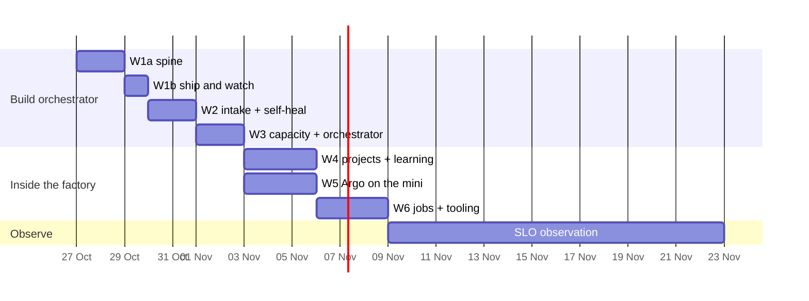

# 12. The plan

The core idea goes first: W1a proves that a lead takes a request through the factory without you,
and W1b that it ships to production with evidence the factory checks. Self-heal and intake follow,
then capacity and the orchestrator. From W3's gate on, the factory builds the rest of itself.

Moving the reasoning into the lead shrinks the factory's own code. Gone from v2.1's plan: the
investigation sessions, the plan-to-Tasks compiler, the merge lane, the base-branch verification
runner and automatic rollback.

## Phase 0 — done 2026-10-24

- **Max-only code.** dotfiles: `rd` refuses OpenCode kinds and pauses instead of spilling; the IU
  launchers are gone. agent-gateway: `implement` and its escalation run on Max with no IU fallback.
- **Two accounts live** with pace guard and 5-hour balance; `c --resume` keeps its account; quota
  history and picker decisions reach Argo.
- **v1's runnable plans parked** in dotfiles and warden, so no wave agent starts them.

## Waves

**Built by the build orchestrator, one wave after another:**

| Wave | Builds | Gate |
|-|-|-|
| **W1a Spine: one lead, start to close** | `factory` repo (this document moves into its `docs/`); Postgres schema (§6); the Issue machine with its inbox, FIFO claims, golden and replay tests; oRPC router → CLI + HTTP API; `factory issue new\|show\|phase\|note\|wait\|ask\|block\|ship\|close\|drop\|merge\|split` and `factory status`, with project, model and effort set by flags and defaults until W2 and W3; the `Runner` port with the herdr adapter and a worktree per attempt; the SessionStart, Stop and SessionEnd hooks, active only in factory sessions and failing open into a spool; Witness, including walls (§5) and pane ownership; startup reconciliation and Issue ids that survive a restore; decision cards and stall lines to one Slack channel until W5; heartbeat push to Kuma; nightly dump and restore drill; warden switched off by its checklist (§2) | a docs request goes from `factory issue new` to closed without you; §11's W1a gamedays pass: kill mid-spawn and mid-work, a lead that stops unreported, an injected usage wall, the restore |
| **W1b Ship and watch** | `project.yaml` v0 as a Zod schema that W4 extends (name, `deploy`, `ship`, `leads`, hold, probes) for the factory repo, dotfiles, jkrumm.com and weatherorb, with the make targets they need (dotfiles' probe runs each hook against a sample payload); the evidence check derived from what the merged commits touched (§4); hold, then `make verify` and the probes; tab and worktree closed after both pass; the transcript archive at close | a UI change in jkrumm.com and a service change in weatherorb's API go from `factory issue new` to closed without you, each with production evidence naming the deployed commit; the seeded-bug gameday passes |
| **W2 Intake and self-heal** | adapters for Kuma, GitHub (issues labelled `factory` and `/factory` comments as requests; `alert` issues as signals) and TickTick (`#factory` items in; `factory issue block --human` items out); the request API that Argo (W5) and Hermes (W6) will call; settle and the `restart` runbook from the homelab's manifest; rules dedup and the judge in shadow (§8); related signals as notes to a running lead, which records same or different; classification; "seen before"; the daily changelog to the brain; warden's code and database deleted; Kuma's Slack alerts removed and its retries raised | the `glance` gameday and the kill-mid-runbook gameday; a GitHub issue you label `factory` is shipped and closed with the summary as a comment; a flapping `alert` issue becomes one Issue, not a lead per repeat; golden set ≥ 0.889 |
| **W3 Capacity and the orchestrator** | admission classes with the 5-hour check, the reserves and stop the line (§5); model and effort per lead, escalation one tier up; the orchestrator: its events, `factory issue prio\|dep\|retier\|park` and `factory project pause`, initiative plans and wave reviews; scorecard v0 | two leads in parallel across both accounts; the both-walled gameday; an injected 5-hour wall on `me` pauses a lead and resumes it without a typed `continue`; one orchestrator run on a seeded backlog meets a written checklist (every stall handled, priorities only within a class, no card outside the business classes); one small initiative planned into waves and shipped |

**Then built inside the factory,** as initiatives the orchestrator plans into child Issues, one lead
per Issue, in parallel across repos:

| Wave | Builds | Gate |
|-|-|-|
| **W4 Projects, intake breadth, learning** | the manifest schema in full with the drift check and `factory project check`, the make contract and journey probes for every repo with signals; adapters for Beszel, Docker on three hosts, HyperDX and ClickHouse, RollHook, launchd failures (`jobs-grade` included), CrowdSec and Slack, each source's Slack alerts removed; the learning loop: known fixes and runbook candidates from leads' reports | drift check green on every manifest; the attack gameday; the judge's precision, recall and pair count on the scorecard, and its stage set by them (§8) |
| **W5 Cockpit** | Argo and its data on the mini; *Now*, *Projects*, *Factory*, *Usage*, *Artifacts*, mobile first; web push, which takes decision cards over from Slack; `factory decide\|artifact`; the briefing; the changelog view; OpenTelemetry to ClickStack | Argo answers its question catalogue from the mini, on the phone; a report is reviewed in *Artifacts*; the VPS Argo and plannotator are stopped |
| **W6 Jobs and tooling** | the first jobs (§9), the scorecard in full; generated AGENTS.md blocks; skills on the `agw` CLI and agent-gateway's MCP removed; `rd` verbs under `factory`; `factory issue resume`, `job` and `session`; Hermes restructured as the chat front; `agw dispatch implement` and its headless lane retired, since a factory Issue does their job; pele in the dataviz skill and the artifact view | every job green at zero tokens on a clean run; the first upgrade Issue shipped by a lead; resident tool tokens per session measured down |

**Side changes in agent-gateway, outside the waves,** each its own session after sign-off:
- **`otel` off Max** onto a cheap OpenCode route. It returns query results, never a cause, so it stays
  within §5's rule; the model (DeepSeek Flash or Haiku) is picked on ten recorded `otel` queries.
- **Review-depth gating:** light review for small diffs, full review where it matters (§5).

Then **14 days of observation** for the SLOs in §11. Built only on a measured trigger: embeddings and
vector search (§8); the scorers, the tuning job and the next jobs (§9); health and traffic pages
(§10); the background-session adapter, once it leaves research preview (§6).

## Lanes

The dates are illustrative; the start is your sign-off. ≈ 13 build days on the critical path (W6
needs W4's manifests and W5's *Artifacts*), then two weeks of observation.

## Who builds it, and on what

**The build runs one level deeper than the factory it builds,** because each wave touches several
repos (the factory, dotfiles, agent-gateway, the homelab, the gate repos). Until W3's gate:

| Level | Who | Does | Model |
|-|-|-|-|
| **Build orchestrator** | one tab in the SourceRoot workspace | holds this plan, the budget and both accounts; opens a wave orchestrator per wave, checks each gate against its evidence, decides what starts next and on which account; reads verdicts and gate evidence, never diffs or logs | Opus at medium |
| **Wave orchestrator** | one orchestrated `/wave` tab per wave, fanning out per repo where the wave spans several | plans its wave into sessions, briefs them, reads their reports and diffs, owns the wave's verdict | Opus at medium |
| **Workers** | the wave's sessions and their subagents | build and test | Sonnet at medium; Haiku for mechanical moves; Opus only for novel hard logic, named in the wave plan with the reason |

- **Fresh at every boundary.** The build orchestrator restarts at each gate from `STATUS.md` and this
  section; a wave orchestrator ends with its wave. Nothing compacts mid-wave.
- **Max sets the pace, not the calendar.** Before each wave and each spawn, the build or wave
  orchestrator reads `claude-account usage` and starts work only on an account whose 5-hour headroom
  covers it. It pauses rather than spills, and keeps the reserves of §5 free.
- **W1a measures its own cost per session.** Those numbers budget the remaining waves and set the
  headroom per model tier in §5.
- **From W3's gate,** the factory's orchestrator takes the build orchestrator's place and leads take
  the wave orchestrators': W4 to W6 run as initiatives inside the factory, and a lead uses a `/wave`
  chain as its tool when its child Issue is long. The orchestrator of orchestrators stays; from W4 on,
  it is the factory itself.

**Cost.** A median wave session is ≈ 19M tokens, ≈ 0.3 % of an `iu` week; a p90 session is 86M, ≈ 1.2 %
(v1 `kpi/forecast`). Seven waves at three to eight sessions each are 21–56 sessions: ≈ 6–17 % of one
`iu` week at the median, ≈ 67 % if every session ran at p90. Budget ≈ 20–40 % and expect less.
**Capacity now:** `iu` stands at 90 % until Wed 28 Oct 16:00 and `me` at 24 % until Thu 29 Oct 06:00,
so the first waves run on `me`, paced by its 5-hour window, until `iu` resets.

## Starting

**After your sign-off of this version; nothing starts before it.** Then the build orchestrator starts
in the SourceRoot workspace, reads §4, §5, §6 and this section, and opens W1a's wave orchestrator.
