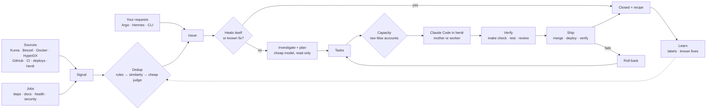

# 1. Verdict

**Build one loop that takes every piece of work — an outage, a bug, a stale dependency, a feature you
asked for — through the same path: deterministic code does everything it can, cheap models judge,
Claude Code on your two Max subscriptions writes every line of code in herdr, and verification gates
every ship. It runs as one new `factory` service on the mini, on Postgres with DBOS, with Argo as the
cockpit on the same box. Warden is switched off, not migrated.**

The bottleneck is not tokens. v1 measured it: 32 % of new items reached you (74 of 230 in 14 days),
≈ 62 owner-facing notifications a week, 50 `continue` nudges in 45 days — and only 3.8 % of the
escalations were genuinely yours. The scarce resources are your attention and the Max windows; IU
money is not (all agent-gateway dispatch work cost $4.31 last week; review, the biggest line, $136).

## The target in ten points

1. **One loop for all work.** Incidents, bugs, hygiene findings, upgrades and your feature requests are
   all Issues. A wave plan is a set of Tasks. Nothing has a side door.
2. **Three engines, each with one job.** Deterministic code (adapters, rules, runbooks, make targets)
   spends nothing. Cheap models on IU (Haiku 5.5, DeepSeek V4.1 Flash, through agent-gateway) triage,
   investigate, plan, review and write briefings. Claude Code on Max writes code — only there, only
   in herdr.
3. **Two Max accounts behave as one pool.** The account is picked at spawn and never changes inside a
   session, so the prompt cache survives. Urgent work takes any headroom; everything else waits for
   its window; nothing spills to IU.
4. **A new `factory` repo** with one TypeScript service on Node 24, Postgres 18 and DBOS. One router
   generates the CLI agents use, the API Argo uses and the routing block in every AGENTS.md.
5. **Every repo describes itself** in `project.yaml` and implements one make contract. CI, agents,
   review and the ship step all call the same targets.
6. **Dedup is deterministic first and learns.** Fingerprint, topology and time window group signals
   (F1 0.889 on the held-out set). Similar past issues are retrieved for the investigator. A cheap
   judge settles only the ambiguous residue. Every merge and split becomes a label.
7. **Self-healing starts with waiting.** A grace window lets transient failures recover; a known fix
   runs as a deterministic runbook; only then does an agent investigate.
8. **Verification, not you, gates shipping.** Checks are keyed to the commit they ran on; a new commit
   voids them. A failed post-deploy check rolls back to the last good deploy.
9. **Recurring jobs are pipelines.** A deterministic probe, an assertion and — only when something is
   found — a cheap summary. A green run costs zero tokens.
10. **You decide business only.** Product direction, spend, irreversible data loss, other people. Each
    reaches you as a three-line card with a default and an expiry, in Argo. SLO: under 1 % of items,
    stretch 0.1 %.

## The numbers

| Metric | Baseline (v1 evidence, 2026-10-22) | Target |
|-|-|-|
| New items that reached you, 14 d | **32.2 %** (74 / 230) | < 1 %, stretch ≤ 0.1 % |
| Owner-facing notifications | **≈ 62 / week** | ≤ 2 / week + one morning briefing |
| `continue` nudges to parked agents | **50** in 45 days | 0 |
| Signals arriving through Slack relays | **63.7 %** of 1,761 | ≤ 5 % (Slack stays only for sources with no other path) |
| Grouping F1, held-out golden set | warden 0.744 → rules **0.889** | ≥ 0.889, rising with labels |
| Known-fix match | **0.479** (failed its 0.50 bar) | ≥ 0.6 after W9 |
| Automatic revert on a failed post-deploy check | **0 of 52** merges | 100 % |
| Max load, 30 d | **120 %** of one weekly window (`kpi/forecast`) — before the second account | ≤ 85 % of the combined pool, owner sessions never blocked |
| IU spend, personal estate, last 7 d | **$183** (review $136, research $32, all dispatch $4.31) | + $50–95 / week, most of it review of factory Tasks |

## Decided

| # | Decision | Section |
|-|-|-|
| 1 | New repo `factory`; warden off, data archived read-only, nothing imported | §13 |
| 2 | Code is written only by Claude Code on Max in herdr; IU never writes code (agent-gateway's implement lanes moved to Max on 2026-10-24) | §3, §5 |
| 3 | Factory judgment runs on cheap models through agent-gateway's OpenCode server | §4, §5 |
| 4 | Postgres 18 on the mini; DBOS for durable workflows, pinned version + patches; acceptance re-run of spike 2 in W1, v1's ledger design as the fallback | §6 |
| 5 | TypeScript on Node 24; oRPC router → HTTP API + CLI (trpc-cli) + generated docs | §10 |
| 6 | Argo moves to the mini and reads the factory database | §10 |
| 7 | `project.yaml` + make contract + autonomy per path in every repo | §7 |
| 8 | Dedup in three tiers with a label loop | §8 |
| 9 | Recurring jobs as zero-token-when-green pipelines; no Renovate | §9 |
| 10 | One open business decision: a third subscription, triggered by measured waiting time | §14 |
