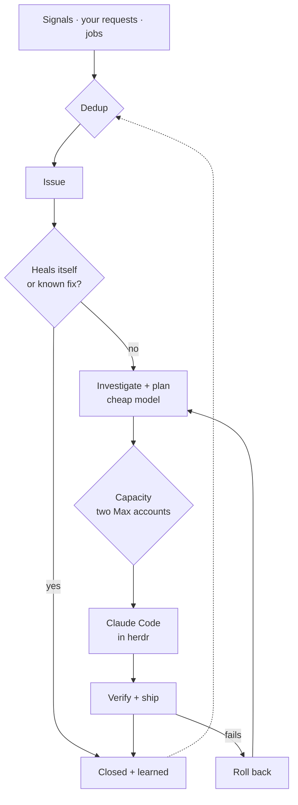

# 1. Verdict

**Build one loop that takes every piece of work — an outage, a bug, a stale dependency, a feature you
asked for — through the same path: deterministic code does everything it can, cheap models judge,
Claude Code on your two Max accounts writes every line of code in herdr, and verification gates every
ship. It runs as one new `factory` service on the mini — a reconcile loop over Postgres, in Bun — with
Argo as the cockpit on the same box. Warden is switched off, not migrated.**

The scarce resources are your attention and the Max windows, not money. 32 % of new items reached
you in v1's 14-day sample, at ≈ 62 notifications a week, and only 3.8 % of those escalations were
genuinely yours. IU API spend for all personal gateway work was $183 last week, most of it review.

## The target in ten points

1. **One loop for all work.** Incidents, bugs, hygiene findings, upgrades and your requests are Issues;
   a wave plan is a set of Tasks. Nothing has a side door.
2. **Three engines, one job each.** Deterministic code spends nothing. Cheap models on IU API tokens
   (Haiku 5.5, DeepSeek V4.1 Flash, agent-gateway's decision model) triage, investigate, plan and
   review. Claude Code on Max writes code — only there, and only in herdr.
3. **Two Max accounts, one pool.** The account is picked at spawn and kept while its cache is warm.
   Urgent work takes any headroom, normal work respects pace, upkeep uses capacity that would lapse.
   Nothing spills to IU API tokens; work waits for the reset.
4. **A reconcile loop, not a workflow engine.** Every few seconds each open Issue and Task is
   re-observed, its state derived from facts, and at most one next action taken. A crash, a redeploy
   or a reboot costs one tick.
5. **Every repo describes itself** in `project.yaml` and implements one make contract that CI, agents,
   review and the ship step all call.
6. **Dedup is deterministic first and learns.** Rules group signals (F1 0.889 on the held-out set);
   a decision model scores the ambiguous rest; the investigator merges and splits; every grouping
   decision is kept as a label.
7. **Self-healing starts with waiting.** A grace window lets transient failures recover; a known fix
   runs as a deterministic runbook; only then does an agent investigate.
8. **Verification gates shipping, and the candidate cannot weaken it.** Checks run on the merge result
   with the base branch's own Makefile and tests; a failed post-deploy check rolls back to the last
   deploy that held.
9. **Upkeep is cheap code.** Jobs are small scripts that spend zero tokens when nothing is wrong.
10. **You decide business only** — product direction, spend, irreversible data loss, other people —
    as a three-line card with a default and an expiry. SLO: under 1 % of items reach you.

## The numbers

| Metric | Baseline (v1 evidence) | Target |
|-|-|-|
| New items that reached you, 14 d | **32.2 %** (74 / 230) | < 1 % |
| Notifications to you, 28 d | **≈ 62 / week** | ≤ 2 / week + the morning briefing |
| `continue` nudges to parked agents, 45 d | **50** | 0 |
| Grouping F1, held-out golden set | warden 0.744 → rules **0.889** | ≥ 0.889 |
| Automatic revert on a failed post-deploy check | **0 of 52** merges | every failed check |
| Max load, 30 d | **120 %** of one `iu` week = **80 %** of today's two-account pool | your sessions never blocked |
