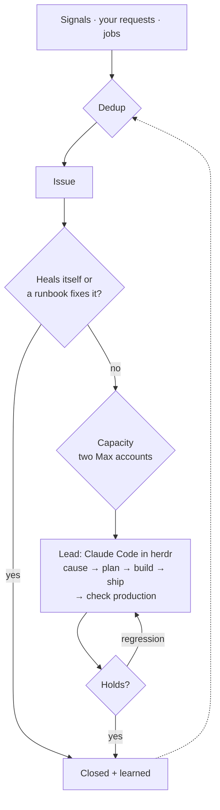

# 1. Verdict

**Build a factory that runs the lifecycle of every piece of work and lets Claude Code do the work.
The factory (plain code, with cheap models for routine judgment) takes in signals and requests,
merges duplicates, heals what a runbook can heal, and queues the rest. It then starts a Claude Code
session on the right Max account with the problem and its evidence. That session, the lead, owns the
Issue from root cause to a verified production change and reports back; the factory watches the
result, closes the Issue and learns. It runs as one new `factory` service on the mini over Postgres,
with Argo as the cockpit on the same box. Warden is switched off, not migrated.**

The scarce resources are your attention and the Max windows, not money. In v1's 14-day sample, 32 % of
new items reached you, at ≈ 62 notifications a week, and only 3.8 % of those escalations were
genuinely yours. IU API spend for all personal gateway work was $183 last week, most of it review.

## The target in ten points

1. **One lifecycle for all work.** Incidents, bugs, upkeep findings and your requests are Issues; an
   initiative is an Issue whose waves are child Issues. Nothing has a side door.
2. **Claude Code owns the work, end to end.** A lead finds the root cause, plans, builds (alone or
   with workers), tests, reviews, ships, checks production and reports. It decides how.
3. **The factory owns the lifecycle, never the reasoning.** Intake, dedup by symptom, settle,
   classify, queue, capacity, watch, learn. Every repo describes itself in `project.yaml` and one make
   contract, so the same commands work everywhere.
4. **The brief is the problem, not a diagnosis.** Facts, evidence and verified history; no cheap-model
   root cause or plan for the lead to unlearn.
5. **Cheap models do the routine around it, freely:** dedup judging, classification, wording, the
   changelog, learning write-ups, job summaries, and the review and research tools leads call.
6. **Two Max accounts, one pool, 5-hour aware.** Each lead gets a model and effort sized to its Issue
   and an account with headroom for it. Urgent work takes any headroom, upkeep only what would lapse.
   Nothing spills to IU API tokens.
7. **Two layers of agents: an orchestrator over the leads.** The orchestrator plans initiatives into
   waves, steers stuck leads and watches queue and accounts, in short sessions woken per event. It
   never writes code.
8. **Done means production evidence.** The lead ships only with the evidence its change needs, fixes
   forward when production disagrees. After the hold, the factory runs `make verify` and the
   project's journey probes, which no lead writes.
9. **It learns, and turns learning into code.** Grouping decisions become labels; verified causes
   become known fixes; a fix verified twice becomes a runbook or a job check that code runs from then on.
10. **You decide business only:** product direction, spend, irreversible data loss, other people. Each
    decision arrives as a three-line card with a default and an expiry. SLO: under 1 % of items reach you.

## The numbers

| Metric | Baseline (v1 evidence) | Target |
|-|-|-|
| New items that reached you, 14 d | **32.2 %** (74 / 230) | < 1 % |
| Notifications to you, 28 d | **≈ 62 / week** | ≤ 2 / week + the morning briefing |
| `continue` nudges to parked agents, 45 d | **50** | 0 |
| Grouping F1, held-out golden set | warden 0.744 → rules **0.889** | ≥ 0.889 |
| Code fixes shipped and checked in production without you | **0**: v1's code fixes stayed propose-only | the default |
| Max load, 30 d | **120 %** of one `iu` week = **80 %** of today's two-account pool | your sessions never blocked |
