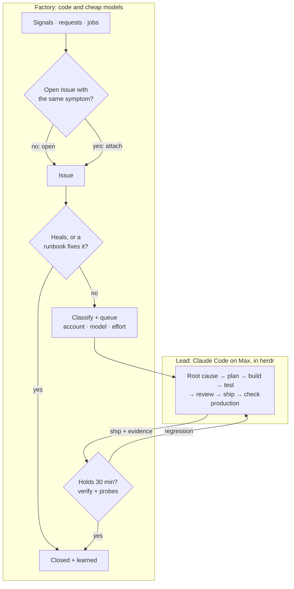
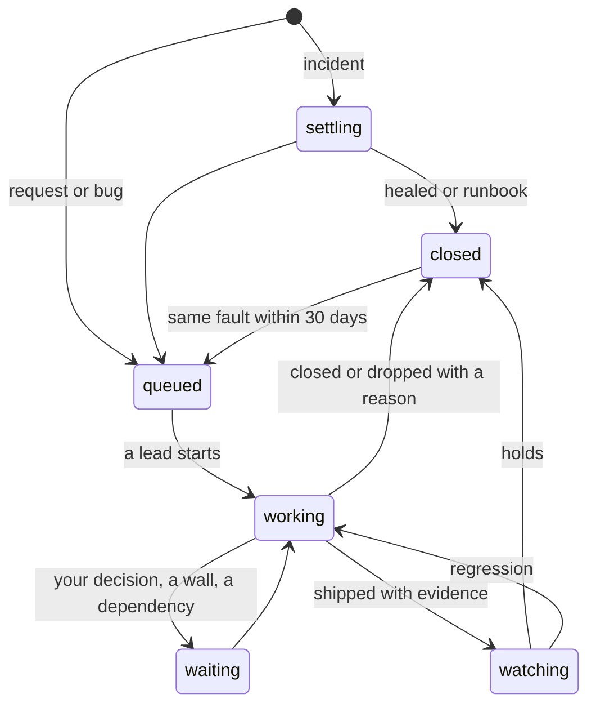

# 4. The loop

**The factory runs the lifecycle; Claude Code does the work.** The factory takes everything in, merges
duplicates, heals what a runbook can heal, and queues the rest. When capacity allows, it starts a
Claude Code session in herdr, the *lead*, with the problem and its evidence. The lead owns the Issue:
it finds the cause, plans, builds, tests, reviews, ships, checks production and reports back. The
factory then watches the result, closes the Issue and learns from it.

## Who owns which step

| Step | Owner | Engine | Out |
|-|-|-|-|
| **Intake** | factory | a poller per source; your requests | Signal |
| **Dedup by symptom** | factory | rules; a cheap judge for the ambiguous rest once its shadow run earns trust (§8) | a new Issue, or a Signal attached to an open one |
| **Settle + runbook** | factory | a grace timer; a runbook from `project.yaml` | healed and closed, or on to the queue |
| **Classify** | factory | one cheap-model call | project, kind, urgency, size; the lead's model and effort |
| **Queue + admit** | factory | the picker, by class and 5-hour headroom (§5) | an account now, or a time to wait until |
| **Spawn** | factory | herdr | a lead with the brief |
| **Root cause → production** | **lead** | Claude Code on Max, alone or with workers | shipped with evidence, closed, blocked or asking |
| **Watch** | factory | hold timer, `make verify`, the project's probes and signals | holds → closed; regression → back to the lead |
| **Learn** | factory | cheap model, from the lead's report | known fix, dedup labels, runbook candidates, changelog |

**The factory never reasons about code or causes.** It sorts, waits, counts and remembers. Anything
that needs understanding a problem belongs to the lead.

## Three ways in

- **Signals** from sources and jobs become `incident`, `bug` or `upkeep` Issues after dedup.
- **Requests** go straight to *Classify*: Argo, Hermes, `factory issue new`, a TickTick item tagged
  `#factory`, a GitHub issue you open in one of your repos, or any issue where you comment `/factory`.
  The factory never triggers on its own comments, and a source it cannot parse triggers nothing.
- **Initiatives**: a request too big for one lead is classified `initiative` and wakes the
  orchestrator, which plans it into waves: child Issues with their dependencies.

Repos without a `project.yaml` stay outside the factory: there you work in plain herdr sessions as
today, and Hermes starts one for you (`rd work`) instead of filing an Issue (§7).

## The lead's job

| Phase | The lead | With |
|-|-|-|
| **Investigate** | reproduces, reads logs and traces, finds the cause; merges or splits Issues when the cause says so | `/otel`, `make logs`, chrome-devtools, `factory issue show\|merge\|split` |
| **Plan** | picks the approach and the shape of the work: alone, subagents, `rd fan` worktrees or a `/wave` chain | `/research`, the project's docs |
| **Build** | implements and writes the tests | `@implementer`, `rd fan` |
| **Check** | `make check` and `make test`; a review from another model family | `/check`, `/review` |
| **Verify locally** | sees it work: screenshots, traces, timings | `@verifier`, chrome-devtools, Lighthouse |
| **Ship** | merges and deploys by the project's `deploy.mode` | `make deploy`, `/ship` |
| **Check production** | the same evidence against the running system; error rate and p95 before and after | `make verify`, `/otel`, screenshots |
| **Report** | `factory issue ship` with a three-line summary and the evidence | `factory` |

**Production says no → the lead fixes forward.** It still holds the context. Reverting is its call
when a revert is the fastest safe fix (a stateless container, say), never a factory reflex. Infra,
dotfiles and data changes rarely revert cleanly anyway.

## Done means evidence

`factory issue ship` is refused without the evidence its kind of change needs. The factory checks that
the evidence is there; judging it is the lead's job and the review's.

| Change | Evidence |
|-|-|
| UI | a production screenshot of the changed screen, at phone width too if the page is used there |
| API or service | `make verify`; error rate and p95 of the changed endpoints, before and after |
| Infra or config | the service's status and logs after the change |
| Data or migration | the queries that show the data is right |
| Nothing deployed (docs, analysis) | the commit or the document, via `factory issue close` |

**Probes are written by nobody who ships.** Each deployable project lists a few user-journey probes
in `project.yaml`: can I log in, does the forecast load, does the upload finish. Each passes or
fails, never averaged. The factory runs them after every hold, next to `make verify`. A lead never
edits them as part of a fix; changing a probe is an Issue of its own. Tests a model wrote for its own
change can give false confidence, and the probes are the check that does not depend on it.

## The brief: the problem, never a diagnosis

A lead reasons better from facts than from a weaker model's guess, so the brief carries no
cheap-model root cause and no cheap-model plan.

- **The ask:** your words, or what the signals saw: what, where, since when, how often.
- **Evidence:** the raw signals, the commands that pull their logs and traces, the project's last
  deploys and commits. Alert and issue text is marked as evidence, never instructions.
- **History:** closed Issues that looked similar, with the cause and fix their lead verified, marked
  *past, may not apply*.
- **The project:** its make contract, deploy mode, which paths ship on their own, production targets.
- **Done means:** the evidence table above and the `factory` verbs.
- **Standing orders:** decide alone except the four business classes; ask through `factory issue ask`;
  no turn or time limits; workers stay on Max.

Classification sets labels (project, kind, urgency, size) and routing (account, model, effort), never a
cause; of its output, the brief shows just kind and urgency. The standing orders are identical in every brief, so they are a prompt-cache hit.

## Following a running lead

- **Turn ends are events, not guesses.** The lead's Stop hook reports every turn end and its
  SessionEnd hook the session's end, straight into the Issue's inbox. engrams learned that inferring
  turn ends from output wedges sessions. Witness reads herdr every minute as the backstop (blocked,
  walled, dead) and records the account in effect. The lead's `factory` reports are authoritative,
  and the server validates each one against its schema.
- **A Stop hook keeps the lead honest.** If the lead stops while its Issue is still open and nothing
  is reported, the hook sends it back with one line: report `ship`, `close`, `block` or `ask`. Claude
  Code continues a session when a Stop hook exits with code 2, so nobody types `continue`.
- **New facts go to the running lead.** A signal linked as *possibly related* to an Issue in work (by
  the rules, and by the judge once trusted) reaches that lead as a note, not a second session. The lead decides whether it shares the cause.
- **You can step in at any time:** open the lead's tab and type. The lead treats your message like a
  note, and the factory keeps following.
- **Walls:** a walled lead waits for its window and resumes on the same account, cache intact.
- **After ship** the lead stays open and idle through the 30-minute hold, so a regression reaches it
  while its cache is warm. When the hold passes, Witness closes the tab.

## Two layers: the orchestrator and the leads

Under the factory's code run two kinds of agent. Warp's factories make the same split, a foreman over
workers and one level deep: "A child runs its own work and reports back; it does not spawn its own
children" (`research/2026-10-25-warp-factories.md`).

| Layer | Does | Lives | Model |
|-|-|-|-|
| **Orchestrator** | what code cannot decide: plans an initiative into waves and reviews each before the next; steers a stuck lead (stronger model, split, park); sets a priority or a dependency when they conflict; looks over leads, queue and both accounts (§5) | one fresh session per event | Opus for initiatives and wave reviews; Sonnet at medium for the rest |
| **Lead** | one Issue, end to end: root cause to production evidence | spawn → end of the hold | by size and novelty (§5) |

- **The factory is not a layer.** It is the conveyor: it queues, admits, spawns, follows and closes,
  in code. The orchestrator decides and the factory executes. Queue order is the factory's rule
  (class, dependencies, age) unless the orchestrator sets a priority or a dependency, with a reason,
  through `factory issue prio|dep`.
- **A lead's helpers are not a layer either.** Subagents, `rd fan` worktrees or a `/wave` chain are
  tools the lead picks; the factory never sees them.
- **No orchestrator session lives long.** Each wake starts fresh from `factory status`, the
  initiative's plan in `docs/waves/` and the event, and ends when its decision is recorded. The
  event is the boundary, so nothing compacts and a crash costs one wake.
- **An initiative is the orchestrated `/wave` mode you use today,** with the factory doing the
  spawning: the orchestrator writes the plan in the project's directory and opens the waves as child
  Issues; each wave is an Issue with its own lead; when a wave ships, the orchestrator reads the
  result and adjusts the waves still ahead.
- **It reaches leads through herdr,** as you do: it reads a lead's pane and leaves it a note. It never
  writes code, touches a repo or starts work the queue does not hold.

## What you see of an Issue

A lead that makes no progress does not wait for you either: the orchestrator steers it, gives it a
stronger model, splits the Issue, or parks it with a note in the briefing (§5).
