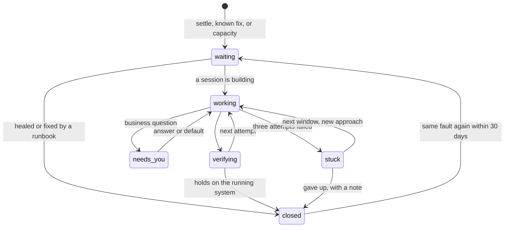

# 4. The loop

One path for every piece of work. Each stage has one engine and records facts; state is derived.

| Stage | Engine | In → out |
|-|-|-|
| **Intake** | adapters that poll each source's current state, plus your requests | → Signal |
| **Dedup** | rules; a decision-model score for the ambiguous rest (§8) | Signal → new or existing Issue |
| **Settle** | a timer | the Issue waits its grace window; if the source reports healthy, it closes as *self-healed* |
| **Known fix** | a runbook from `project.yaml` (restart, rerun a backup, roll back) | action, then a fresh look |
| **Investigate + plan** | cheap model in an agent-gateway OpenCode session, read-only tools | root cause, plan, Tasks, acceptance checks, optional business question |
| **Decide** | policy; you only for business | answer, or the default on expiry |
| **Admit** | the picker, by class (§5) | a Task gets an account now, or a time to wait until |
| **Implement** | Claude Code on Max in herdr | commits on `factory/<task-id>` |
| **Verify** | the base branch's make targets on the merge result; agent-gateway review | checks keyed to (head SHA, base SHA) |
| **Ship** | deterministic merge, `make deploy`, `make verify`, hold window | a deploy that holds, or a rollback |
| **Learn** | deterministic; a cheap summary only for investigated Issues | root cause, fix recipe, grouping labels |

## Three ways in

- **Signals** from sources and jobs pass dedup and become Issues: `incident`, `bug`, `upkeep`.
- **Requests** — Argo, Hermes, a TickTick item tagged `#factory`, `factory issue new` — skip dedup and
  settle and start at *Investigate + plan*. A request that already has a plan starts at *Admit*.
- **Wave plans** (`/wave`, or a plan an investigation produced) are Tasks with dependencies. The plan
  file keeps the prose and the task ids; the factory keeps the state.

## What you see of an Issue

Six states in Argo; the reconciler keeps finer steps internally. **Stuck has an exit that does not
need you:** after three failed attempts the Issue waits for the next capacity window, gets one more
attempt with a fresh investigation that is told why the earlier ones failed, and then closes as
*gave up* with a line in the briefing. A new signal re-opens it.

## The reconcile loop

The `factory` service is one Bun process. It holds a Postgres advisory lock, so a second copy exits
at start. Every five seconds, and immediately on a `NOTIFY` from new facts, it picks up every Issue and
Task whose `wake_at` has passed or whose facts changed, and for each:

1. reads its facts and the current state of the world it depends on (the container, the PR, the
   session's pane, the deploy);
2. derives its state;
3. takes at most one next action through the effect registry, keyed by
   `(entity, generation, step)` — an effect that already happened is observed, never repeated;
4. records the outcome as a fact and sets the next `wake_at`.

Long work is started, then observed: spawning a session, starting an investigation or a deploy is
one action; its progress arrives as facts on later ticks. Nothing waits in memory, so a crash, a
redeploy of the factory itself or a reboot loses at most one tick. Re-opening an Issue or un-sticking
it bumps its `generation`, so effects from an earlier generation can never land twice.

After downtime, every open deadline is shifted by the time the factory was down, so a decision you
could not answer while Argo was dark does not take its default the second the mini comes back.

## The brief every session gets

Sent on every spawn and every resume, generated from the Task. The standing-orders part is identical
across spawns, so it stays in the prompt cache; the task part comes last.

- **Goal and done-definition** — the acceptance checks, as commands.
- **Scope** — repo, files, what is out of bounds.
- **Context** — the Issue, the investigation, similar past Issues and how they were fixed.
- **Branch** — `factory/<task-id>`. Never rebase another branch, never merge, never touch the
  Makefile, CI or test configuration unless the Task says so.
- **Report** — `factory task done|blocked|note`. The factory, not the agent, decides when a Task is done.

## Witness

Witness is part of the factory process. It watches herdr and records facts per session: spawned
(with an epoch number), output seen, idle, blocked on a question, hit a usage wall (and its reset
time), exited, and the account actually in effect. The Task reconciler reads those facts — there are
no messages to lose. Rules:

- **Done** needs the agent's `factory task done`, no new commit for five minutes and an idle pane.
  The pane is then stopped before verification starts, so nothing lands after the checks.
- **A usage wall is not idleness.** The idle watchdog is suspended until the reset; the Task re-enters
  admission (§5).
- **A dead pane** is respawned from the branch. Three deaths in ten minutes without a new commit mark
  the Task blocked and send it back to planning.
- **Stuck sessions** get at most one interrupt every three minutes, never a `continue` from you.
- **Finished workers' tabs are closed** when their Task closes.

## Workers and mothers

- **Every Task gets a fresh worker by default** — a Claude Code session in herdr with the brief.
- **Fleet projects keep a mother** (basalt-ui, argo, weatherorb, shutterflow, factory): the session that
  owns that project's multi-wave plans, as basalt-ui's does today. Tasks from her plan go to her, and
  she may fan out workers on disjoint files. Incident fixes and small requests do not wake her.
- **A follow-up goes where the cache is warm:** within the hour, to the session that did the work.
- **Idle mothers** are compacted or closed by the herdr hygiene job once the first one idles past a
  day (§9); finished workers' tabs close with their Task from W2.

## Verification the candidate cannot weaken

- Required checks run in a factory-owned checkout of the merge result (the branch rebased onto the
  current tip), using **the base branch's** Makefile, CI and test configuration.
- A change that touches the verification surface — Makefile, CI, test config, `project.yaml`, verify
  scripts — gets a full review whose adversary is asked one question: does this weaken verification?
  Test and check counts may not drop. If either fails, the Task goes back to planning; it does not
  stop at you.
- **No evidence, no auto-ship.** A project without `make test` or `make verify` cannot auto-ship code;
  the factory first opens a Task to add the missing target.
- **Acceptance checks are written from the plan, not the diff:** a separate fresh session reads the
  plan and turns its acceptance checks into smoke steps in `make verify`.

## Merge, deploy, hold, roll back

1. **Merge**, one at a time per repo: rebase onto the current tip, re-run the changeset checks on the
   result, then fast-forward the default branch to exactly that commit (or merge the PR with its head
   SHA pinned, in the PR-required repos). A moved tip means rebase and check again.
2. **Deploy** by the project's `deploy.mode` (§7): automatic on push, `make deploy`, or an *agentic*
   deploy — a Max Task whose done-definition is `make verify` passing on the target.
3. **Hold.** `make verify` must pass, then the deploy must stay free of new signals for its hold window
   (30 minutes by default) before it counts as *held*.
4. **Roll back** to the last held deploy if verify or the hold window fails, and mark the failed
   artifact bad so it is never shipped again. If the rollback itself fails, the project is paused and
   you get one card.
5. **Migrations** are declared in `project.yaml`. Additive (expand/contract) migrations ship like code;
   a migration that drops data is a business decision whose default on expiry is *do not proceed*.

## The factory ships itself differently

The factory cannot deploy itself from inside its own loop. Its `make deploy` is a small script
outside the loop: build a release, swap it in, wait for health and one synthetic Issue to round-trip,
and swap back to the last held release if either fails. The loop only calls it and observes the
result.
