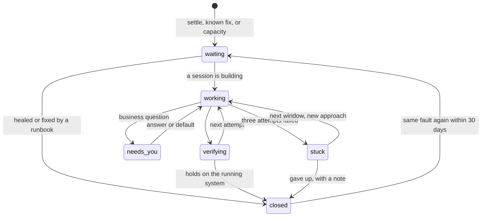

# 4. The loop

The factory's job is to classify, order and prepare work so well that Claude Code can just do it.
Everything around the session — intake, dedup, planning, capacity, verification, shipping — exists to
hand Claude Code a clear task with the right context and tools, and then get out of its way.

| Stage | Engine | In → out |
|-|-|-|
| **Intake** | adapters that poll each source, plus your requests | → Signal |
| **Dedup** | rules, then cheap models for the ambiguous rest (§8) | Signal → new or existing Issue |
| **Settle** | a timer | transient failures heal and close as *self-healed* |
| **Known fix** | a runbook from `project.yaml` (restart, rerun a backup, roll back) | action, then a fresh look |
| **Investigate + plan** | cheap model in an agent-gateway OpenCode session | root cause, plan, ordered Tasks, acceptance checks |
| **Admit** | the picker, by class (§5) | a Task gets an account now, or a time to wait until |
| **Implement** | Claude Code on Max in herdr | fixed, tested, committed on `factory/<task-id>` |
| **Verify + ship** | make targets, agent-gateway review, merge, deploy, hold | shipped, or rolled back and re-planned |
| **Learn** | cheap model | root cause, fix recipe, grouping labels |

## Three ways in

- **Signals** from sources and jobs pass dedup and become Issues: `incident`, `bug`, `upkeep`.
- **Requests** — Argo, Hermes, a TickTick item tagged `#factory`, `factory issue new` — start at
  *Investigate + plan*. A request that already has a plan starts at *Admit*.
- **Wave plans** (`/wave`, or a plan an investigation produced) are Tasks with dependencies. The plan
  file keeps the prose; the factory keeps the state.

## What you see of an Issue

**Stuck never waits for you.** After three failed attempts the Issue waits for the next capacity
window, gets a fresh investigation that is told why the earlier attempts failed, and otherwise closes
as *gave up* with one line in the briefing. A new signal re-opens it.

## What every Claude Code session gets

This is the part that matters most. A session is only as good as what it is handed.

- **A brief** generated from the Task, re-sent on every spawn and resume: goal and done-definition (the
  acceptance checks as commands), scope, the investigation, similar past Issues and how they were
  fixed, the branch `factory/<task-id>`. Its standing-orders part is identical every time, so it is a
  prompt-cache hit.
- **The tools to see and act:** the repo's make contract (`check`, `test`, `deploy`, `verify`, `logs`,
  `restart`), `agw` for OTel traces and logs, review and checks, `research` for docs, chrome-devtools for
  UIs, `factory` for its own Task (`task done|blocked|note`, `issue show`), and the project's notes.
- **Full autonomy inside its Task:** it investigates further, fixes, writes tests, verifies. It asks
  only through `factory task blocked`, and the factory answers — another investigation, a decision by
  policy, the decision model — before anything reaches you.
- **Room to work:** no turn limits and no time limits, only the idle watchdog.

## Workers and mothers

- **Every Task gets a fresh worker by default** — a Claude Code session in herdr with the brief.
- **Fleet projects keep a mother** (basalt-ui, argo, weatherorb, shutterflow, factory) for their
  multi-wave plans, as basalt-ui does today. Tasks from her plan go to her; she may fan out workers.
- **A follow-up goes where the cache is warm:** within the hour, to the session that did the work.
- **Witness** watches herdr: it notices a finished, blocked, walled or dead session, resumes parked
  sessions when their window opens, closes finished workers' tabs, and never asks you to type
  `continue`.

## Verify, ship, roll back

- **Checks run on the merge result** with the base branch's own Makefile and tests, so a change cannot
  weaken the checks that judge it. A project without `make test` or `make verify` cannot auto-ship code
  until a Task adds them.
- **Review** by agent-gateway — cheap angles plus a DeepSeek adversary from another model family.
- **Merge**, one at a time per repo, onto the current tip; **deploy** by the project's `deploy.mode`
  (§7); **hold** for 30 minutes without new signals; on failure **roll back** to the last deploy that
  held and re-plan.
- **Migrations that drop data** are the one ship-time decision that can reach you, with *do not proceed*
  as the default.

The edge cases behind these lines — merge races, dead panes, usage walls, restores — are handled in
the implementation, listed in appendix D.
