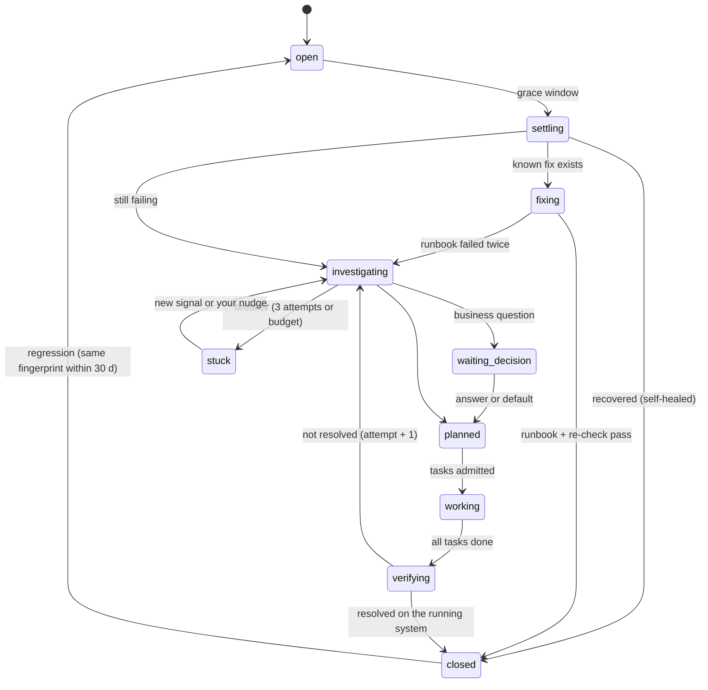

# 4. The loop

One path for every piece of work. Each stage has one engine and writes facts; status is derived.

| Stage | Engine | In → out | Cost |
|-|-|-|-|
| **Intake** | deterministic adapters | source event → Signal (with source time and fingerprint) | 0 |
| **Dedup** | rules, then similarity, then a cheap judge for the residue (§8) | Signal → new or existing Issue | ≈ 0; judge ≈ $0.001 a call |
| **Settle** | durable timer | Issue waits its grace window; a recovery closes it as *self-healed* | 0 |
| **Known fix** | deterministic runbook from `project.yaml` (restart, rerun backup, roll back) | Issue → action + re-check | 0 |
| **Investigate + plan** | cheap model in an OpenCode session through agent-gateway, read-only CLIs | Issue → root cause, plan Artifact, Tasks, risk class, optional business question | ≈ $0.55 (agw dispatch, last 7 d: $4.31 / 8 jobs) |
| **Decide** | policy; you only for business | question → outcome (default on expiry) | 0 |
| **Schedule** | capacity scheduler (§5) | Task → admitted on an account, or waiting | 0 |
| **Implement** | Claude Code on Max in herdr: the project's mother, or a worker it spawns | Task → commits on `factory/<task-id>` | Max window |
| **Verify** | make targets, agent-gateway review (cheap angles + a DeepSeek adversary from another model family), holdout scenarios | commit → Checks keyed to the head SHA | 0 + ≈ $2.40 per full review ($136 / 56 last week) |
| **Ship** | deterministic: squash merge, `make deploy`, `make verify` | Change → Deploy → post-deploy Check; fail → rollback | 0 |
| **Learn** | deterministic + cheap summary | closed Issue → root cause, fix recipe, labels | ≈ 0 |

## Three ways in

- **Signals** from sources and jobs go through dedup and become Issues of kind `incident`, `bug`,
  `hygiene` or `upgrade`.
- **Requests** from you (Argo, Hermes, `factory issue new`) skip dedup and settle, and start at
  *Investigate + plan* as kind `request`. A request that already carries a plan starts at *Schedule*.
- **Wave plans** (`/wave`, or a plan an investigation produced) are Tasks with dependencies. The plan
  file keeps the prose and the task ids; the factory keeps the state.

## Issue lifecycle



`stuck` is not a page. It shows in *Now* and in the briefing with one line on why; a new signal or a
steer re-opens it.

## The workflow, as code

Each Issue is one DBOS workflow; each Task is a child workflow on the `implement` queue. A crash, a
redeploy or a reboot resumes at the last finished step. The shape (TypeScript, DBOS 5):

```ts
const handleIssue = DBOS.registerWorkflow(async (issueId: string) => {
  const issue = await DBOS.runStep(() => issues.load(issueId), { name: "load" });

  // Settle: transient failures recover inside the grace window.
  const recovered = await DBOS.recv<"recovered">("recovered", { timeoutSeconds: issue.graceSeconds });
  if (recovered) return DBOS.runStep(() => issues.close(issueId, "self-healed"), { name: "close" });

  // Known fix: a deterministic runbook, then a re-check.
  if (issue.runbook && (await DBOS.runStep(() => runbooks.apply(issueId), { name: "runbook" })).ok) {
    return DBOS.runStep(() => issues.close(issueId, "runbook"), { name: "close" });
  }

  for (let attempt = 1; attempt <= 3; attempt++) {
    const plan = await DBOS.runStep(() => cognition.investigate(issueId, attempt), { name: `investigate-${attempt}` });
    if (plan.question) await decisions.await(plan.question); // recv with expiry → default
    const tasks = await DBOS.runStep(() => work.createTasks(issueId, plan), { name: `tasks-${attempt}` });
    await Promise.all(tasks.map((t) => DBOS.startWorkflow(runTask, { queueName: "implement" })(t.id).then((h) => h.getResult())));
    if (await DBOS.runStep(() => issues.isResolved(issueId), { name: `resolved-${attempt}` })) {
      return DBOS.runStep(() => issues.close(issueId, "fixed"), { name: "close" });
    }
  }
  await DBOS.runStep(() => issues.markStuck(issueId, "three attempts"), { name: "stuck" });
}, { name: "handleIssue" });
```

`runTask` admits the task (§5), spawns or wakes the session in herdr, then waits on `recv` for
Witness' `done`, `blocked` or `dead` message — no timeout on the work itself, only the idle watchdog.
It then runs the checks, ships, and on a failed post-deploy check rolls back and opens a follow-up
Task. Every external effect is a step with an idempotency key `(task id, step)`; a step re-run after
a crash first observes whether the effect already happened (the PR exists, the deploy is live).

## The brief every session gets

Taken from pstack, sent on every spawn and every resume, generated from the Task:

- **Goal and done-definition** — the checks that must pass on the final commit.
- **Scope** — the repo, the files the plan names, and what is out of bounds.
- **Context** — the Issue, the investigation, similar past issues and their fixes.
- **Branch** — `factory/<task-id>`; one writer per branch; never rebase another branch, never merge.
- **Report** — `factory task done|blocked|note`, with the head SHA. The factory, not the agent, decides
  that the task is done.

## Witness

Witness observes herdr and keeps facts about sessions: started, output seen, idle, blocked, exited.
It sends the task workflow `done` after `factory task done` plus a five-minute settlement window,
`blocked` when herdr reports a question, `dead` when the pane is gone. A session parked by a quota
wall is resumed by the scheduler when its account has room — on the same account, so the cache
holds. A stuck session gets one interrupt at most every three minutes (agent-orchestrator's rule),
never a `continue` from you.

## Mothers and workers

- **Fleet projects** (basalt-ui, argo, weatherorb, shutterflow, factory) have a mother: a Claude Code
  session per project that the scheduler wakes with a Task. It may split the Task across workers in
  herdr (`rd fan` today, `factory spawn` later) on disjoint files, and it integrates their branches.
- **Session projects** (everything else, including dotfiles) get a fresh worker per Task.
- **Cache affinity:** a project's next Task goes to its live mother while her cache is warm (one hour);
  after that a fresh wake starts from the project's notes and the Issue history.
- **Rotation:** the herdr hygiene job (§9) compacts or closes mothers idle for more than a day, and
  closes finished worker tabs.

## Ship and roll back

Squash merges keep every Change one revert away. The deploy is the project's `make deploy`; its
wrapper records a Deploy with the artifact digest. Post-deploy `make verify` passes or the previous
good Deploy is redeployed and the digest is marked bad; the ship step refuses a bad digest. A
project whose deploy is not automatic (§7) stops after the merge and records "merged, not deployed".
