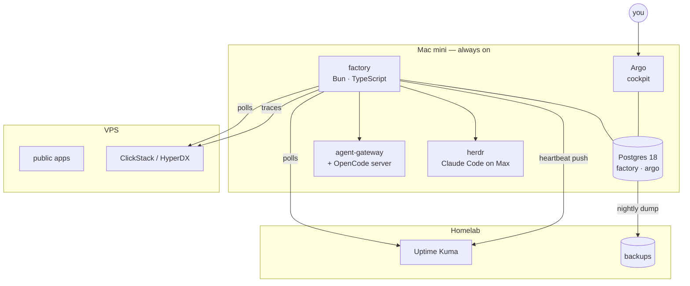

# 10. Surfaces

## Where everything runs



## Intake

The mini can reach the homelab and the VPS; they cannot reach the mini. So the factory **polls** —
Kuma's monitor states, Beszel, Docker on the three hosts, HyperDX alerts and ClickHouse error clusters,
GitHub issues and checks, RollHook deploys, failed launchd jobs, CrowdSec decisions, TickTick. Polling
the current state also means a missed recovery is caught on the next read. The few sources that can
only notify Slack arrive through a **Slack adapter**. Nothing listens on a public address.

**GitHub requests.** An issue you open in one of your repos is a request; so is any issue, yours or
someone else's, where you comment `/factory`. Only your GitHub user counts. The lead's summary goes
back as a comment, and the issue closes when the factory's Issue does.

Each source is repointed when its adapter lands: its Slack notifications are removed and Kuma's
retries raised, so transient blips heal before they become signals. The one alert that stays outside
the factory is the dead-man: the factory pushes a heartbeat (loop lag, last tick, a database write) to
the homelab Kuma, which alerts through its own channel if the heartbeat stops.

## Argo, on the mini

Argo moves from the VPS to the mini at W5 and reads the factory's Postgres directly: views for reads,
`LISTEN/NOTIFY` for live updates. Its life pages and their data move with it. Each page answers named
questions (v1's question catalogue, `design/argo.md` §2), and every number shows its age. All of it
works on the phone as on the computer — it is a PWA behind the tailnet, with mobile layouts.

| Page | Answers |
|-|-|
| **Now** (home) | Does anything need me? Is the factory healthy? The morning briefing lives here. |
| **Projects** | How is each project doing — open Issues, leads, deploys, cost, TickTick, changelog? (your wireframe) |
| **Factory** | What runs, what waits and until when, which account, model and effort each lead uses? What did the orchestrator do? How does the scorecard look (§9)? |
| **Usage** | How much of each Max window is used and by what; IU API spend by source? |
| **Artifacts** | Which plans and reports wait for my comments? A comment reaches the agent that wrote it. |

Health and traffic link out to Beszel, Kuma and Umami at first; they get pages when a question needs
one. Writes are intents — submit, steer, pause, decide, comment, re-verify, stop — calls to the factory
API, executed by the loop. The UI is basalt-ui; what Argo needs and basalt-ui lacks is built in
basalt-ui first.

## Notifications

Argo's web push notifies for two things — a decision card and the morning briefing — and opens the
matching page. Slack is nearly gone: it keeps Hermes' chat and the channels of the few sources that
can only post to Slack. The dead-man alert comes from Kuma, through whichever channel Kuma uses.

## The `factory` CLI

One oRPC router defines every operation with Zod input and output. From it come the HTTP API Argo and
Hermes call, the CLI (`trpc-cli` reads oRPC routers) and the docs. The generated AGENTS.md block lists
only what agents need, to keep resident tokens small:

```
factory status
factory issue new|show|phase|merge|split
factory issue ask|block|ship|close|drop
factory project check
```

`ship` takes the three-line summary and the evidence; `ask` puts a decision card to you with a default
and an expiry. The rest (`issue resume`, `job`, `session`, `artifact`, `decide`, the orchestrator's verbs (`prio`, `dep`, `steer`), …) exists for
you, the orchestrator and Argo and is documented once, not in every repo. Every command writes data to stdout and messages to stderr, takes `--format
json|md`, exits non-zero on failure and never prompts an agent.

## Tools around it

- **Gateways stay CLI-first:** `agw`, `research`, the audio, email and image CLIs. MCP remains only for
  research-gateway and chrome-devtools; agent-gateway's MCP registration goes in W6, once the skills
  that use it call the `agw` CLI.
- **`rd`** keeps working; its spawn, fan, merge and say verbs move under `factory` in W6 and `rd`
  becomes an alias.
- **Hermes is restructured in W6** as the factory's chat front: status and requests through the factory
  API ("do X" becomes `factory issue new`; "how is X going" reads the Issue and its lead's phase), its
  crons become factory jobs, its narration becomes the briefing. It never implements.
- **Diagrams** are written as Mermaid and rendered by pele, here and in the dataviz skill, and in Argo's
  *Artifacts* page (the page lands in W5, pele rendering in W6).

## What is switched off, and when

| Thing | When |
|-|-|
| agent-gateway implement on IU API tokens | Phase 0, done 2026-10-24 |
| warden, its Slack relay, Hermes' project narratives | W1 (warden deleted) |
| agent-gateway's headless implement lane | W1 stops its only caller (warden); W6 removes the lane |
| raw Slack alerts from each source | as its adapter lands (W2 Kuma, W4 the rest) |
| Argo on the VPS | W5 |
| plannotator and its review door | W5 |
| agent-gateway MCP registration | W6 |
