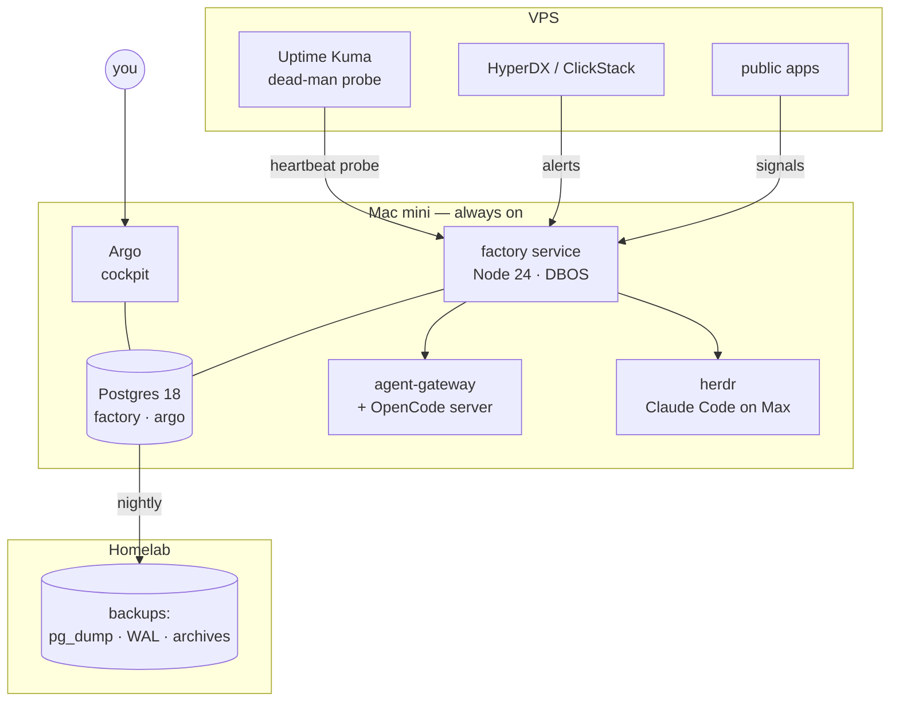

# 10. Surfaces: Argo, the CLI, Hermes, notifications

## Where everything runs



## Argo, on the mini

Argo moves from the VPS to the mini at W6 and reads the factory's Postgres directly — views for read
models, `LISTEN/NOTIFY` → server-sent events for live updates. No push sync, no snapshot endpoint.
The life pages and their data move with it (your call: "B. All on the mini"). v1's method stays: each
page answers named questions (`design/argo.md` §2, 27 canonical questions + 4), and every number shows
how old it is.

| Page | Answers | Built from |
|-|-|-|
| **Now** (home) | Does anything need me? Is the factory healthy? | open decisions, `stuck` Issues, factory health, the dead-man state |
| **Projects** | How is each project doing? (your wireframe, `26-10-21-argo-projects-wireframe`) | per project: health, open Issues, Tasks, last deploys, sessions, usage, traffic, changelog |
| **Factory** | What runs, what waits, why? | Issues by stage, the queue with "waiting for capacity until …", live sessions with account, DBOS workflow steps |
| **Health** | Are the hosts and services fine? | infra job signals, containers, databases, backups, certs |
| **Usage** | How much of each window is used, by what? | quota samples of `iu` and `me`, pace, picker decisions, IU spend by source |
| **Traffic** | Who uses the apps? | Umami per app (custom events and goals added per app in W8) |
| **Artifacts** | What is waiting for my comments? | plans and reports with threads; a comment reaches the authoring agent |
| **Briefing** | What happened overnight? | the morning briefing, with audio |

Writes are intents (ADR-015, kept): submit, steer, pause, decide, comment, re-verify, stop — each a
call to the factory API, executed by the loop, visible as an event.

The UI is basalt-ui. What Argo needs and basalt-ui lacks is built in basalt-ui first (v1
`design/argo.md` §5); the *basalt-ui upstream* job (§9) keeps the direction honest.

## Notifications

- **Push** comes from Argo (web push to the installed PWA) for exactly two things: a decision card,
  and the morning briefing.
- **The mini going dark** cannot be announced by the mini. Uptime Kuma on the VPS probes the factory's
  heartbeat and alerts through its own channel (Slack today). That is the only alert that bypasses
  Argo.
- **Slack** stays as Hermes' chat and as an intake adapter for the few sources that can only post to
  Slack. It stops being the factory's relay: sources with an API or a webhook connect directly.
- **Public webhooks** for sources outside the tailnet (GitHub, SaaS alerting) arrive through one
  Tailscale Funnel path, `/ingest/<source>`, with a per-source signature check. Polling is the
  default where a source allows it (GitHub every 10 minutes).

## The `factory` CLI

One oRPC router defines every operation with Zod input and output. From it:

- **the HTTP API** Argo and Hermes call (oRPC 1.x, typed client, OpenAPI 3.2 for anything else);
- **the CLI** agents and you use (`trpc-cli`, which reads oRPC routers);
- **the docs**: `factory --help --format json` renders the routing block in every repo's AGENTS.md and
  the CLI reference — generated, never hand-edited.

```
factory status                                  # one screen: stages, queue, sessions, capacity
factory issue  new|list|show|merge|split|close
factory task   list|ready|claim|done|blocked|note
factory wave   run|status <plan>
factory session list|resume|stop
factory decide list|answer
factory job    list|run|dry-run
factory project list|show|check|new|pause
factory artifact submit|comments|resolve
```

Agent contract on every command (clig.dev, `gh`): data on stdout, messages on stderr, `--format
json|md`, non-zero exit on failure, no prompts unless a TTY and no agent detected.

**Why oRPC + trpc-cli and not cyclopts:** cyclopts is the cleanest code-derived CLI there is, but it is
Python, and the factory's main consumer is Argo — TypeScript, TanStack Query, same box, same database.
One TypeScript router gives Argo typed calls (`@orpc/tanstack-query`) and agents a CLI from the same
definition. `incur` would add MCP from the same tree but is at 0.7; MCP is not needed (ADR-004).

## Tools around it

- **Gateways stay CLI-first** (ADR-004): `agw`, `research`, and the audio, email and image CLIs; MCP only
  for research-gateway and chrome-devtools. agent-gateway's MCP registration is removed in W10, which
  also takes its tool definitions out of every session's resident context.
- **`rd`** keeps working; its spawn, fan, merge and say verbs move under `factory` in W10, and `rd`
  becomes an alias.
- **Hermes** is a thin chat: it answers status from the factory API, turns "do X" into
  `factory issue new`, and reads the briefing. It never implements.

## What is switched off

| Thing | When |
|-|-|
| warden (loop, poll, sweep, API, backup) | W0 — data archived read-only |
| Slack → warden relay, Hermes "Project narratives" | W0 |
| agent-gateway implement on IU | Phase 0, done 2026-10-24 |
| Argo on the VPS | W6 |
| plannotator Inbox + its review door | W7 |
| agent-gateway MCP registration | W10 |
