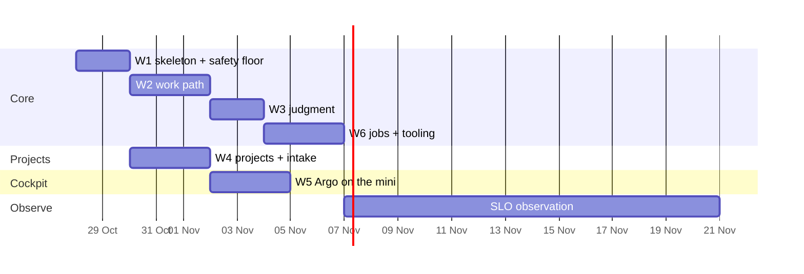

# 12. The plan

Safety floor first: the first wave already heals one failure class, survives its own crashes and
restores its own database. Then the work path, then judgment; the factory builds the rest of itself
from W3.

## Phase 0 — done 2026-10-24

- **Max-only code.** dotfiles: `rd` refuses OpenCode kinds and pauses instead of spilling; the IU
  launchers are gone. agent-gateway: `implement` and its escalation run on Max with no IU fallback;
  overrides that would move them onto IU API tokens are refused.
- **Two accounts live** with pace guard and 5-hour balance; `c --resume` keeps its account; quota
  history and picker decisions reach Argo.
- **v1's runnable plans parked** in dotfiles and warden, so no wave agent starts them.

## Waves

| Wave | Builds | Gate |
|-|-|-|
| **W1 Skeleton and safety floor** | `factory` repo (this document moves into its `docs/`); warden switched off and deleted with its Slack relay and Hermes' narratives; Postgres schema and the reconcile loop in Bun; the Kuma adapter, Kuma's Slack alerts removed and its retries raised; rules-based dedup; settle and the `restart` runbook from a minimal manifest for the homelab; heartbeat push; nightly dump and restore drill; the factory's own deployer with automatic swap-back; `factory status` and `issue` | the durability suite (§6) passes; the `glance`, kill and restore gamedays pass |
| **W2 Work path** | Tasks with dependencies and the ready queue; admission classes in the picker; spawning workers in herdr with the brief; Witness; verification on the merge result with the base branch's targets; merge, deploy, hold, rollback; review-depth gating on in agent-gateway; finished tabs closed | a pre-planned request on a session repo ships end to end without you; the bad-deploy and both-walled gamedays pass |
| **W3 Judgment** | investigations as agent-gateway OpenCode sessions the factory can resume and steer; plans to Tasks with acceptance checks; decision cards and their three-line lint; the dedup score, merge/split, labels, "seen before"; the stuck exit | a one-sentence request ships end to end; three replayed past incidents get plans; golden set ≥ 0.889 |
| **W4 Projects and intake** | `project.yaml` and the make contract for every repo with signals or Tasks; adapters for Beszel, Docker on three hosts, HyperDX and ClickHouse, GitHub, RollHook, launchd failures, CrowdSec, TickTick and Slack; each source's Slack alerts removed | drift check green; the attack gameday passes |
| **W5 Cockpit** | Argo and its data on the mini; *Now*, *Projects*, *Factory*, *Usage*, *Artifacts*; web push; the briefing; OpenTelemetry to ClickStack | Argo answers its question catalogue from the mini; a report is reviewed in *Artifacts*; the VPS Argo and plannotator are stopped |
| **W6 Jobs and tooling** | the first five jobs; generated AGENTS.md blocks; skills on the `agw` CLI and agent-gateway's MCP removed; `rd` verbs under `factory`; Hermes thinned; pele in the dataviz skill and the artifact view | every job green at zero tokens on a clean run; the first upgrade wave shipped; resident tool tokens per session measured down |

Then **14 days of observation** for the SLOs in §11. Built only on a measured trigger: embeddings and
vector search (§8), the next jobs (§9), health and traffic pages (§10).

## Lanes and calendar

≈ 10 build days on the critical path, three lanes, then two weeks of observation. **Max sets the pace, not the
calendar.** A median wave session is ≈ 19M tokens (v1 `kpi/forecast`, p90 86M), ≈ 0.3–1.2 % of an
`iu` week; at three to eight sessions per wave the whole rewrite costs ≈ 20–40 % of one `iu` week on
top of your normal load. `iu` stands at 88 % until Wed 28 Oct 17:00, so the heavy work starts there.

## Starting

Default: **W1 starts on Wed 28 Oct after the `iu` reset**, unless your comments change §4–§12 — or
earlier on the `me` account if you say go. A fresh orchestrator session in the SourceRoot workspace
reads §4, §6 and this section and runs W1 as a `/wave` chain. From W3's gate on, `factory wave run`
queues the remaining waves in the factory itself.
