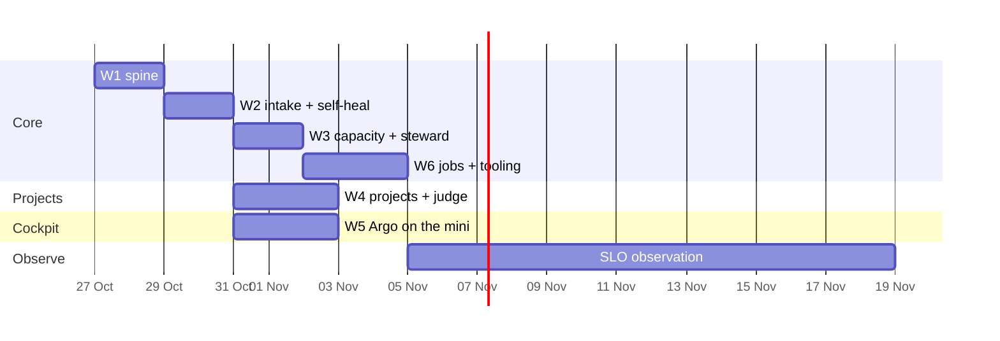

# 12. The plan

The core idea goes first: W1 proves that a lead takes a real request from the factory to a checked
production change without you. Self-heal and intake follow, then capacity and the steward. From W3's
gate on, the factory builds the rest of itself.

Moving the reasoning into the lead shrinks the factory's own code. Gone from v2.1's plan: the
investigation sessions, the plan-to-Tasks compiler, the merge lane, the base-branch verification
runner and rollback.

## Phase 0 — done 2026-10-24

- **Max-only code.** dotfiles: `rd` refuses OpenCode kinds and pauses instead of spilling; the IU
  launchers are gone. agent-gateway: `implement` and its escalation run on Max with no IU fallback.
- **Two accounts live** with pace guard and 5-hour balance; `c --resume` keeps its account; quota
  history and picker decisions reach Argo.
- **v1's runnable plans parked** in dotfiles and warden, so no wave agent starts them.

## Waves

| Wave | Builds | Gate |
|-|-|-|
| **W1 Spine: one lead, end to end** | `factory` repo (this document moves into its `docs/`); Postgres schema (§6); the Issue machine with its inbox, claims, golden and replay tests (or DBOS, per your decision); oRPC router → CLI + HTTP API; `factory issue new\|show\|phase\|merge\|split\|ask\|block\|ship\|close\|drop` and `factory status`; spawning a lead in herdr on the picked account with the brief; Witness; the Stop hook; the evidence check on `ship`; hold, then `make verify` and the probes; heartbeat push to Kuma; nightly dump and restore drill; warden switched off and deleted (Kuma's Slack alerts stay until W2, so there is no blind window) | three real requests (a UI change, a service change, a docs change) go from `factory issue new` to closed without you, each with production evidence; killing the factory mid-spawn and mid-hold and deploying it with Issues parked loses and duplicates nothing; the restore drill passes |
| **W2 Intake and self-heal** | adapters for Kuma, GitHub (your issues and `/factory` comments) and TickTick `#factory`; the request API that Argo (W5) and Hermes (W6) will call; settle and the `restart` runbook from a minimal `project.yaml` for the homelab; rules dedup; related signals routed to a running lead; classification; "seen before"; the daily changelog to the brain; Kuma's Slack alerts removed and its retries raised | the `glance` gameday (a stopped container comes back by runbook, nothing reaches you); a GitHub issue you open is shipped and closed with the summary as a comment; golden set ≥ 0.889 |
| **W3 Capacity and the steward** | admission classes with the 5-hour check; model and effort per lead, escalation one tier up; one lead per repo plus one urgent; the steward and its events; scorecard v0; review-depth gating in agent-gateway | two leads in parallel across both accounts; a 5-hour wall on `me` pauses and resumes a lead without a typed `continue`; the both-walled gameday; one steward run on a seeded backlog, read by you once |
| **W4 Projects, intake breadth, the judge** | `project.yaml`, the make contract and journey probes for every repo with signals or Issues; adapters for Beszel, Docker on three hosts, HyperDX and ClickHouse, RollHook, launchd failures, CrowdSec and Slack, each source's Slack alerts removed; the dedup-judge bake-off (§8); the learning loop: known fixes and runbook candidates from leads' reports | drift check green; the bake-off recorded, and the winner switched on or the judge kept off (§8); the attack gameday |
| **W5 Cockpit** | Argo and its data on the mini; *Now*, *Projects*, *Factory*, *Usage*, *Artifacts*, mobile first; web push; the briefing; the changelog view; OpenTelemetry to ClickStack | Argo answers its question catalogue from the mini, on the phone; a report is reviewed in *Artifacts*; the VPS Argo and plannotator are stopped |
| **W6 Jobs and tooling** | the first jobs (§9), the scorecard job in full; generated AGENTS.md blocks; skills on the `agw` CLI and agent-gateway's MCP removed; `rd` verbs under `factory`; Hermes restructured as the chat front; pele in the dataviz skill and the artifact view | every job green at zero tokens on a clean run; the first upgrade wave shipped by a lead; resident tool tokens per session measured down |

Then **14 days of observation** for the SLOs in §11. Built only on a measured trigger: embeddings and
vector search (§8), the next jobs (§9), health and traffic pages (§10).

## Lanes

The dates are illustrative; the start is your sign-off. ≈ 9 build days on the critical path, three
lanes, then two weeks of observation.

## Who builds it, and on what

**Max sets the pace, not the calendar.** Until the steward exists, one orchestrator tab on the mini
plays its part for the rewrite, the "daddy orchestrator" you asked for:

- **The orchestrator** runs the waves in orchestrated `/wave` mode, on Opus at medium effort. It reads
  worker reports and diffs, never raw logs, and holds the plan and the verdicts.
- **Workers** run on Sonnet at medium effort by default and on Haiku for mechanical moves. Opus only
  for novel hard logic, named in the wave plan with the reason.
- **Before each wave and each spawn** it reads `claude-account usage` and starts work only on an
  account whose 5-hour headroom covers it. It pauses rather than spills, and keeps your 15 % on `iu`
  free.
- **W1 measures its own cost per session.** Those numbers budget the remaining waves and seed the
  admission table in §5.
- **From W3's gate,** the factory's steward takes over, and the waves still open run as an initiative
  inside the factory.

**Cost.** A median wave session is ≈ 19M tokens, ≈ 0.3 % of an `iu` week; a p90 session is 86M, ≈ 1.2 %
(v1 `kpi/forecast`). Six waves at three to eight sessions each are 18–48 sessions: ≈ 5–15 % of one `iu`
week at the median, ≈ 55 % if every session ran at p90. Budget ≈ 20–40 % and expect less. **Capacity now:** `iu` stands at 90 % until Wed 28 Oct
16:00 and `me` at 24 % until Thu 29 Oct 06:00. So W1 and W2 run on `me`, paced by its 5-hour window,
and W3 onwards follows `iu`'s reset.

## Starting

**After your sign-off of this version; nothing starts before it.** Then a fresh orchestrator session in
the SourceRoot workspace reads §4, §5, §6 and this section and runs W1.
