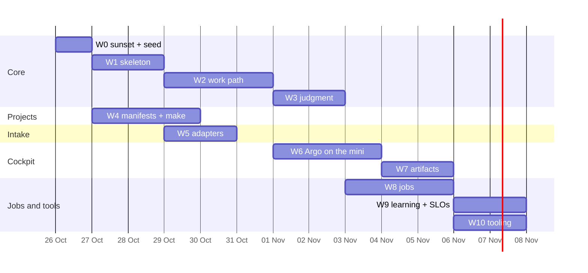

# 13. The plan

Walking skeleton first: by W2 one request and one outage travel the whole loop on one project. Then
widen. From W2 on, every remaining wave is queued in the factory and built through it, so the
factory's first real users are its own waves.

## Phase 0 — before the rewrite (done 2026-10-24)

- **Max-only code.** dotfiles 691ae1b: `rd` refuses OpenCode kinds and pauses instead of spilling;
  `ca`/`cap`/`cdf`/`cdp` removed. agent-gateway: `implement` and its escalation moved to Max with no
  IU fallback, and IU overrides for them are refused.
- **Two accounts live.** Picker v1.2 with pace guard and 5-hour balance, `c --resume` stays on its
  account, quota history and picks synced to Argo.
- **v1's runnable plans paused.** The v1 waves in `dotfiles/docs/waves/PLAN.md` and
  `warden/docs/waves/PLAN.md` are marked superseded, so no wave agent starts them.

## Waves

| Wave | Goal | Repos | Proof gate | Rollback |
|-|-|-|-|-|
| **W0** Sunset and seed | warden off; its data and Hermes' state archived read-only with checksums; Slack relay and project narratives off; `factory` repo created (private, self-hosted runner) with this TDD as `docs/` | warden, hermes-agent, dotfiles, factory | no warden LaunchAgent loaded; archives on the homelab verify; factory CI green | re-load warden's agents (its code and DB are untouched) |
| **W1** Skeleton | Postgres db + DBOS on Node 24; oRPC router → CLI + API; Kuma adapter; tier-1 dedup; the Issue workflow with settle + runbook; Witness v0 | factory | DBOS acceptance suite (spike 2 port) green; **gameday: `glance` stopped → restarted by the runbook in < 5 min, zero owner touch** | stop the service; Kuma alerts still reach Slack |
| **W2** Work path | tasks with deps and ready queue; scheduler + picker; spawn into herdr with the brief; `factory task done`; checks keyed by head SHA; squash merge, `make deploy`, `make verify`, rollback | factory, dotfiles (`rd` hooks) | a request (`factory issue new`) on a session repo shipped end-to-end with zero owner touch; a P3 task waits while both accounts are over pace (simulated sample) | disable the `implement` queue; waves keep running through `rd` |
| **W3** Judgment | investigation and planning through agent-gateway (structured output); decision cards with the three-line lint; tier 2 similarity + tier 3 judge; merge/split by the investigator; new pre-registration frozen | factory, agent-gateway | 3 replayed historical incidents each produce a plan with tasks; golden backtest ≥ 0.889 | judgment off → Issues stop at `investigating` and show in *Now* |
| **W4** Projects describe themselves | `project.yaml` v2 + make contract + directory contract in every SourceRoot repo; `factory project new` templates; drift check in CI; IuRoot manifests in dotfiles-private | all SourceRoot repos, dotfiles-private | drift check green everywhere; **gameday (once W2's ship step exists): a bad deploy on a scratch project reverts itself** | revert the per-repo commits |
| **W5** Intake | Beszel, Docker events on 3 hosts, HyperDX alerts + error clusters, GitHub (poll + Funnel `/ingest`), RollHook, launchd job failures, quota samples, Slack fallback adapter | factory, vps, homelab | over 7 days ≤ 5 % of signals arrive through Slack | per-adapter switch |
| **W6** Argo on the mini | Argo + its data move to the mini's Postgres; *Now*, *Projects*, *Factory*, *Health*, *Usage* on factory views + SSE; web push; briefing page | argo, basalt-ui, vps | Argo answers the canonical questions from the mini; *Now* < 1 s; VPS Argo stopped | DNS / Caddy back to the VPS container |
| **W7** Artifacts | plans and reports with comment threads in Argo; comments reach the authoring agent | argo, factory, basalt-ui | a report reviewed end-to-end in Argo; plannotator and its door stopped | plannotator restarts from its data dir |
| **W8** Jobs | job runner + the §9 catalogue; Umami events and goals in each app; changelog to brain; herdr hygiene | factory, apps, brain | every job green at zero tokens on a clean run; the first upgrade wave shipped by a mother | per-job switch |
| **W9** Learning and SLOs | label loop + weekly refit; blind replay; KPIs in Argo; full gameday suite | factory, argo | 14 days at < 1 % owner touch; known-fix match ≥ 0.6 | refit off, rules frozen |
| **W10** Tooling | AGENTS.md routing blocks generated from the CLIs; agent-gateway MCP removed; `rd` verbs under `factory`; Hermes rewired thin; dotfiles skills pruned | dotfiles, agent-gateway, hermes-agent, all repos | no hand-written routing left; resident tool tokens per session down (measured) | re-register MCP; `rd` unchanged |

## Calendar

≈ 13 days with three lanes. **Max is the clock, not the calendar:** `iu` stands at 88 % of its week
until Wed 28 Oct 17:00, so W0, W1 and W4's templates run on `me` first and the heavy waves start after
that reset. Dates move with capacity; the order does not.

## How to start

1. Read this section and §6's acceptance gate.
2. `rd wave factory '<W0 brief>'` from the SourceRoot workspace (W0 creates the repo; the brief is the
   W0 row plus §10's switch-off table). W1 follows as a chain.
3. From W2's gate on: `factory wave run docs/waves/PLAN.md` in the factory repo queues W3–W10 as Tasks.

## What happened to v1's plan

v1's waves W1a–W14 (`waves.md`) are superseded. Kept and re-homed: the manifest schema (→ W4), the
merge train and rollback (→ W2), intake adapters (→ W5), Argo pages (→ W6), artifacts (→ W7),
recurring jobs (→ W8), SLOs and gamedays (→ W9). Dropped: the history import, the shadow replay, the
SQLite ledger's hand-written leases (unless W1's gate falls back to them), the Argo split, the IU
engine for mothers.
